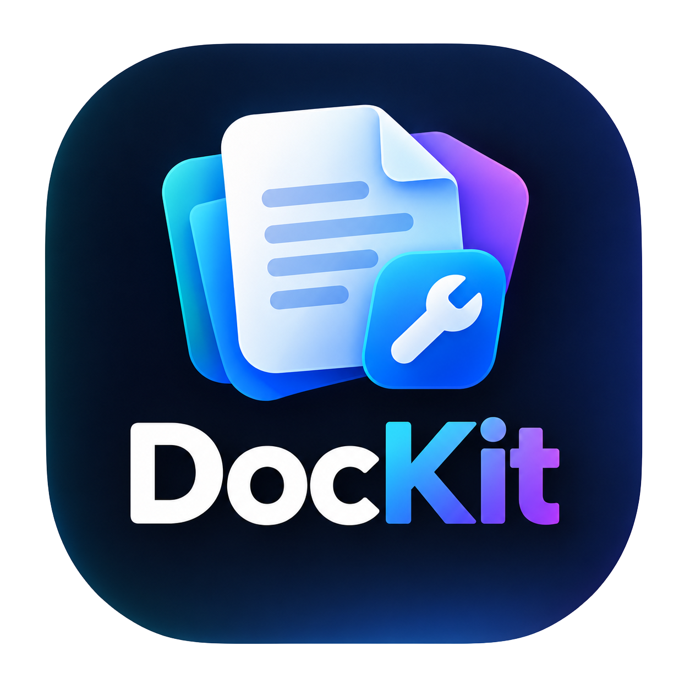
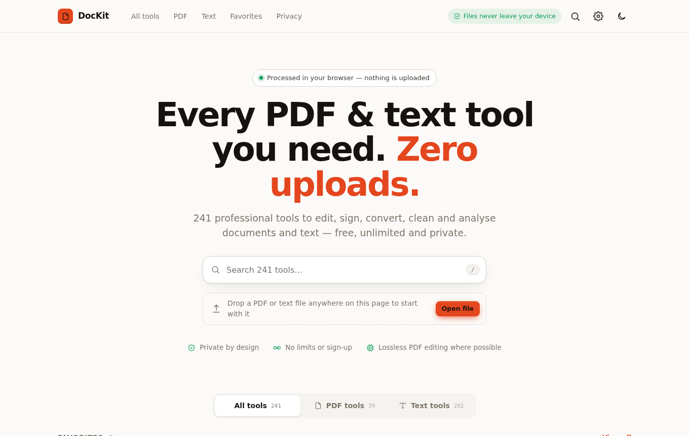
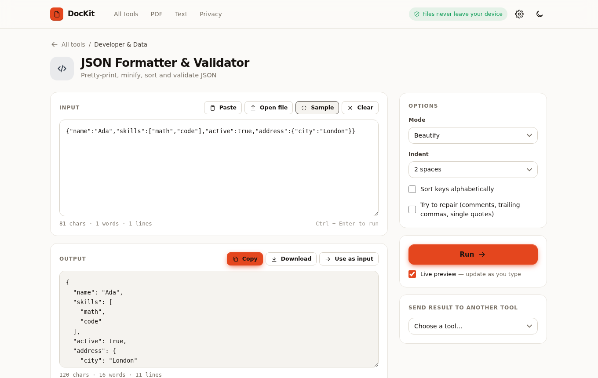
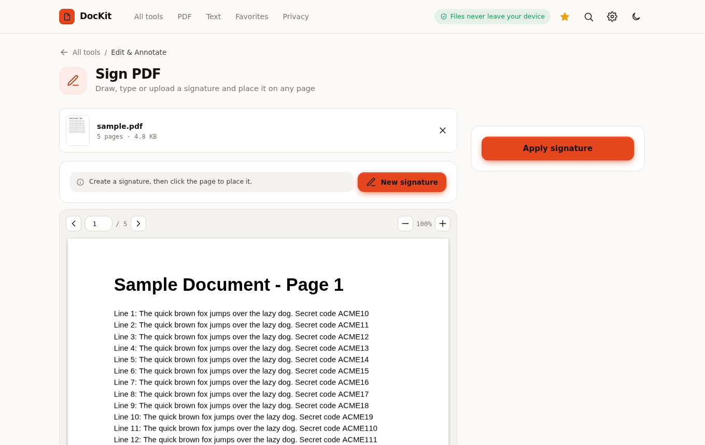
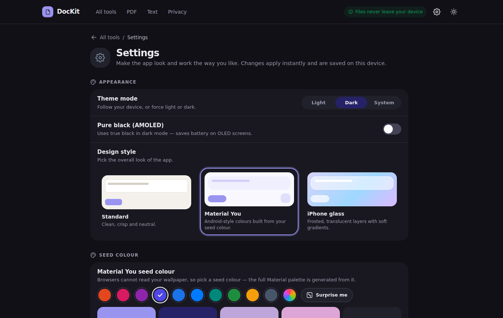
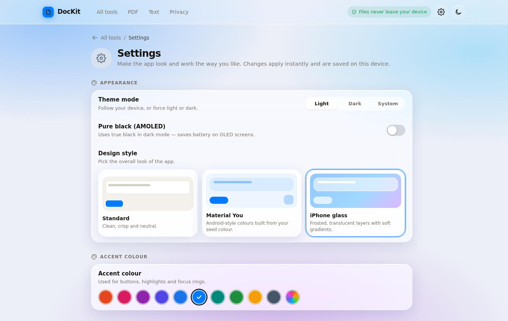
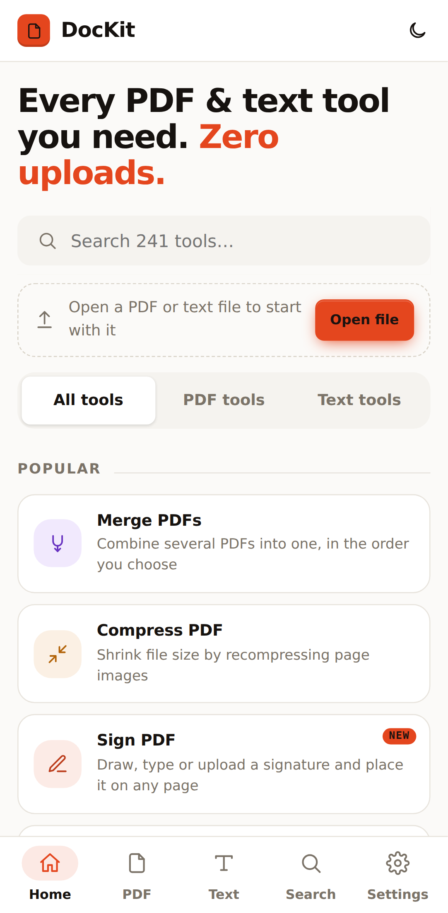
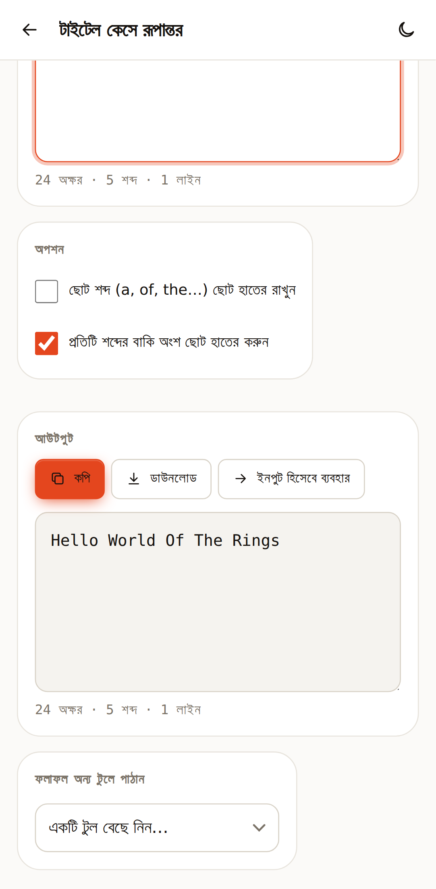

<div align="center">



# DocKit

**Every PDF & text tool you need — with zero uploads.**

241 free tools that run entirely in your browser. Merge, sign, redact and compress PDFs. Format JSON, change case, clean and analyse text. Material You, iPhone-glass and dark themes. English and বাংলা.


[**Live demo**](https://axon469.github.io/DocKit/) · [Report a bug](https://github.com/axon469/DocKit/issues) · [Request a tool](https://github.com/axon469/DocKit/issues)



</div>

---

## Why DocKit?

Most online PDF and text utilities make you upload your files to someone else's server. **DocKit does everything on your own device** — your documents and text never leave the browser tab. There is nothing to install, no account, no limits, and no watermarks.

- 🔒 **Private by design** — all processing happens locally. No uploads, no tracking, no accounts.
- 🧰 **241 tools in one app** — 39 PDF tools and 202 text tools, searchable from one home screen.
- ✂️ **True PDF editing** — merge, split, rotate, watermark, number and crop pages *without* flattening them into images, so text stays sharp and selectable.
- ⚡ **Live text tools** — results update as you type, and you can send any result straight into another tool.
- 📱 **Built for phones too** — the app detects your device and switches to an Android-style layout with a bottom navigation bar and a thumb-reach **Run** button.
- 🎨 **Make it yours** — light / dark / system, AMOLED black, **Material You**, **iPhone glass**, accent colours, text size, density and more.
- 🌐 **English & বাংলা** — switch the whole interface to Bangla (with optional Bangla numerals).
- 📄 **One HTML file** — the whole app is a single `index.html`. Host it anywhere, or just double-click it.

## Screenshots

| Text tool (live preview) | PDF tool (Sign PDF) |
| :---: | :---: |
|  |  |

| Material You (dark) | iPhone glass |
| :---: | :---: |
|  |  |

| Mobile home | Mobile in Bangla |
| :---: | :---: |
|  |  |

## Quick start

### On a computer
 
**Open the file.** Download `index.html` and open it in any modern browser. That's it.
 
**Or serve it locally** (needs Python 3):
 
```bash
python3 -m http.server 8080
# open http://localhost:8080
```
 
### Test on your Android phone with SHTTPS
 
You can run DocKit on your phone without a computer by serving the files with the **SHTTPS** app, a small local web server for Android.
 
1. **Install SHTTPS** on your Android phone from the Play Store.
2. **Put the project on your phone.** Download this repository (**Code → Download ZIP**) and extract it, or copy `index.html` into a folder on your phone, for example `Download/DocKit/`.
3. **Open SHTTPS** and choose that folder as the *root / web directory*, the one that contains `index.html`.
4. **Start the server.** SHTTPS shows an address such as `http://192.168.1.6:8080`.
5. **Open the address in Chrome** on the phone. On the same phone you can also use `http://localhost:8080` (use the port shown in the app).
6. **To test from another device**, connect it to the same Wi-Fi network and open the address SHTTPS shows.
Tips:
 
- Keep SHTTPS running (and allow it in battery-saver settings) while you test.
- **First load needs internet.** DocKit fetches its PDF libraries from a CDN the first time. The page is served locally, but those libraries still come from the internet.
- After you edit `index.html`, pull down to refresh in Chrome. If you still see the old version, clear the site data.

## What's inside

### PDF tools (39)

<details><summary><b>Organize</b> — 13</summary>

- Merge PDFs
- Split PDF
- Extract Pages
- Delete Pages
- Organize Pages
- Rotate Pages
- Duplicate Pages
- Reverse Pages
- Insert Blank Pages
- Remove Blank Pages
- Multiple Pages per Sheet
- Resize Page Size
- Bundle into ZIP

</details>

<details><summary><b>Edit & Annotate</b> — 12</summary>

- Sign PDF
- Add Text
- Add Image / Logo
- Fill Forms
- Watermark
- Page Numbers
- Header & Footer
- Stamps
- Crop Pages
- Redact PDF
- Grayscale
- Invert Colors

</details>

<details><summary><b>Convert</b> — 3</summary>

- PDF to Image
- Images to PDF
- Extract Text

</details>

<details><summary><b>Create</b> — 2</summary>

- Text to PDF
- Markdown to PDF

</details>

<details><summary><b>Security & Privacy</b> — 5</summary>

- Protect with Password
- Unlock PDF
- Flatten PDF
- Remove Metadata
- Edit Properties

</details>

<details><summary><b>Optimize & Inspect</b> — 4</summary>

- Compress PDF
- Repair & Optimize
- Document Info
- PDF Reader

</details>

### Text tools (202)

<details><summary><b>Spacing & Layout</b> — 14</summary>

- Text Spacing Increaser
- Text Line Unwrapper
- Wrap Words in Text
- Indent Text
- Unindent Text
- Justify Text
- Left-pad Text
- Right-pad Text
- Left-align Text
- Right-align Text
- Center Text
- Truncate Text
- Slice Text
- Trim Text

</details>

<details><summary><b>Split & Join</b> — 3</summary>

- Split Text
- Join Text
- Repeat Text

</details>

<details><summary><b>Reverse & Swap</b> — 7</summary>

- Reverse Text
- Reverse Words in Text
- Reverse Sentences in Text
- Reverse Paragraphs in Text
- Reverse Line Order
- Swap Letters in Words
- Swap Words in Text

</details>

<details><summary><b>Words & Sentences</b> — 5</summary>

- Duplicate Words in Text
- Remove Words from Text
- Duplicate Sentences
- Remove Sentences from Text
- Replace Words in Text

</details>

<details><summary><b>Prefix & Suffix</b> — 12</summary>

- Add Prefix to Lines
- Add Suffix to Lines
- Remove Prefix from Lines
- Remove Suffix from Lines
- Add Prefix to Words
- Add Suffix to Words
- Remove Prefix from Words
- Remove Suffix from Words
- Add Symbols Around Words
- Remove Symbols Around Words
- Insert Between Letters
- Add Symbols Around Letters

</details>

<details><summary><b>Lines & Filtering</b> — 8</summary>

- Remove All Empty Lines
- Remove Duplicate Lines
- Filter Text Lines
- Filter Words in Text
- Filter Text Sentences
- Filter Text Paragraphs
- Add Line Numbers
- Remove Line Numbers

</details>

<details><summary><b>Sort & Randomize</b> — 11</summary>

- Sort Text Lines
- Sort Sentences in Text
- Sort Paragraphs in Text
- Sort Words in Text
- Sort Letters in Words
- Randomize Letters in Text
- Scramble Words
- Randomize Words in Text
- Randomize Text Lines
- Randomize Text Sentences
- Randomize Text Paragraphs

</details>

<details><summary><b>Text Case</b> — 7</summary>

- Convert to Uppercase
- Convert to Lowercase
- Convert to Title Case
- Convert to Sentence Case
- Randomize Text Case
- Invert Text Case
- Alternating Case

</details>

<details><summary><b>Line Breaks & Spaces</b> — 15</summary>

- Add Line Breaks
- Remove Line Breaks
- Replace Line Breaks
- Normalize Line Breaks
- Fancify Line Breaks
- Convert Spaces to Newlines
- Convert Newlines to Spaces
- Convert Spaces to Tabs
- Convert Tabs to Spaces
- Convert Comma to Newline
- Convert Newline to Comma
- Convert Spaces to Commas
- Convert Commas to Spaces
- Remove Extra Spaces
- Remove All Whitespace

</details>

<details><summary><b>Letters & Symbols</b> — 12</summary>

- Increment Letters
- Decrement Letters
- Replace Letters in Text
- Convert Letters to Digits
- Convert Digits to Letters
- Duplicate Letters in Text
- Remove Letters from Text
- Replace Vowels in Text
- Duplicate Vowels in Text
- Remove Vowels from Text
- Replace Consonants
- Remove Consonants

</details>

<details><summary><b>Quotes</b> — 6</summary>

- Add Quotes to Text
- Remove Quotes from Text
- Add Quotes to Words
- Remove Quotes from Words
- Add Quotes to Lines
- Remove Quotes from Lines

</details>

<details><summary><b>Encoding & Ciphers</b> — 17</summary>

- ROT13 Text
- ROT47 Text
- Caesar Cipher
- URL-encode Text
- URL-decode Text
- HTML-encode Text
- HTML-decode Text
- Base64-encode Text
- Base64-decode Text
- Convert Text to Binary
- Convert Binary to Text
- Convert Text to Hex
- Convert Hex to Text
- Convert Text to Morse
- Convert Morse to Text
- Convert Text to URL Slug
- Strip HTML Tags

</details>

<details><summary><b>Developer & Data</b> — 9</summary>

- Programming Case Converter
- JSON Formatter & Validator
- CSV to JSON
- JSON to CSV
- CSV to Markdown Table
- Markdown to HTML
- Hash Generator
- Unicode Escape / Unescape
- Number Base Converter

</details>

<details><summary><b>Text Effects</b> — 19</summary>

- Write in Superscript
- Write in Subscript
- Generate Tiny Text
- Write Text in Bold
- Write Text in Italic
- Fancy Text Generator
- Add Underline to Text
- Add Strikethrough
- Generate Zalgo Text
- Undo Zalgo Text Effect
- Create ZigZag Text
- Draw a Box Around Text
- Create a Palindrome
- Check If Palindrome
- Create Mirror Copy
- Generate Text Mnemonic
- Leetspeak Converter
- Pig Latin Translator
- Bionic Reading Text

</details>

<details><summary><b>Analysis & Stats</b> — 19</summary>

- Find Length of Text
- Count Words in Text
- Count Text Lines
- Print Text Statistics
- Find Top Letters
- Find Top Words
- Find Unique Words
- Find Duplicate Words
- Find Unique Letters
- Find Duplicate Letters
- Remove Duplicate Words
- Find and Replace Text
- Compare Text
- Head Text
- Tail Text
- Readability Score
- Keyword Density
- Social & SEO Length Checker
- Count Occurrences

</details>

<details><summary><b>Generators</b> — 6</summary>

- Generate Lorem Ipsum
- Generate Random Text
- Generate Text of Length
- UUID Generator
- Password Generator
- Random Number Generator

</details>

<details><summary><b>Extract & Find</b> — 7</summary>

- Find All Emails
- Find All Web Addresses
- Find All Numbers
- Extract RegExp Matches
- Test Text with RegExp
- Extract Patterns
- Extract Columns

</details>

<details><summary><b>Random & Fake</b> — 10</summary>

- Add Random Words
- Add Random Letters
- Introduce Errors
- Generate Fake Text
- Unfake Text
- Check If Text Is Fake
- Remove Random Letters
- Remove Random Symbols
- Censor Words in Text
- Anonymize Text

</details>

<details><summary><b>Convert</b> — 4</summary>

- Convert Column to Comma
- Convert Comma to Column
- Roman Numeral Converter
- Number to Words

</details>

<details><summary><b>Clean & Remove</b> — 7</summary>

- Remove All Punctuation
- Remove Diacritics
- Remove Digits
- Remove Stop Words
- Remove Invisible Characters
- Strip Emoji & Non-ASCII
- Smart Quotes Converter

</details>

<details><summary><b>Enumerate & Number</b> — 4</summary>

- Enumerate Letters
- Enumerate Words
- Enumerate Sentences
- Enumerate Paragraphs

</details>


## Customisation

Open **Settings** (gear icon on desktop, bottom bar on phones). Everything applies instantly and is saved in your browser.

| Section | Options |
| --- | --- |
| **Appearance** | Light / Dark / System · Pure black (AMOLED) · Standard, **Material You** or **iPhone glass** style |
| **Colour** | 10 presets or any custom colour. In Material You it is the *seed colour* from which a full tonal palette is generated |
| **Shape & text** | Corner roundness · density · text size (85–130 %) · font (Inter / System / Serif) · animations on/off |
| **Catalogue** | List / Grid / Compact layout · show descriptions, icons, NEW badges, counts · Popular and Recently-used rows · start tab · hide categories |
| **Language** | English or বাংলা · Bangla numerals |


## Privacy & limitations

DocKit never sends your files or text anywhere. A few things worth knowing:

- Libraries are loaded from a CDN on first use, so you need to be online the first time.
- **Protect with Password**, **Unlock PDF**, **Compress**, **Grayscale**, **Invert** and **Redact** re-render pages as images. This is what makes redaction truly irreversible, but it means text on those pages is no longer selectable. The tool tells you when this applies.
- **Compress** helps most on scanned / image-heavy PDFs. For text-based PDFs use **Repair & Optimize** (lossless).
- Unlock only works for files you are allowed to open; use it responsibly.
- Text watermarks, stamps and page numbers use the standard PDF fonts. Characters outside Latin text are drawn as images automatically.
- Bangla covers the interface, tool names, descriptions and most option labels. Technical labels (e.g. `SHA-256`, `camelCase`) and all tool *output* stay as they are.
- Material You cannot read your phone wallpaper (browsers don't allow it), so you pick a seed colour instead.

## Tech stack

DocKit is plain HTML, CSS and JavaScript — no framework, no build step needed to *use* it.

| Library | Used for | License |
| --- | --- | --- |
| [pdf-lib](https://pdf-lib.js.org/) | Lossless PDF editing (merge, split, stamp, forms…) | MIT |
| [PDF.js](https://mozilla.github.io/pdf.js/) | Rendering pages, text extraction, thumbnails | Apache-2.0 |
| [JSZip](https://stuk.github.io/jszip/) | ZIP downloads | MIT / GPLv3 |
| [jsPDF](https://github.com/parallax/jsPDF) | Password encryption (loaded only when needed) | MIT |
| [Inter](https://rsms.me/inter/) · [Noto Sans Bengali](https://fonts.google.com/noto/specimen/Noto+Sans+Bengali) | Typography | OFL |

All libraries are loaded from [cdnjs](https://cdnjs.com/) and Google Fonts; nothing is bundled in this repository.

## Project structure

```
DocKit/
├── index.html          ← the complete app (generated — this is what you deploy)
├── build.py            ← builds index.html from src/
├── src/
│   ├── head.html       ← markup shell + all CSS (themes, Material You, glass, mobile layout)
│   ├── core.js         ← APP_NAME, icons, PDF helpers, drawing & rasterising utilities
│   ├── tools.js        ← the 39 PDF tools (options + processing)
│   ├── text-lib.js     ← text-engine helpers, Unicode maps, CSV/MD5/diff helpers
│   ├── text-tools-a.js ← text tools: layout → encoding
│   ├── text-tools-b.js ← text tools: effects → enumerate (+ developer & data tools)
│   ├── stages.js       ← interactive PDF editors (organizer, signature, redact, crop…)
│   ├── settings.js     ← settings page, theming engine, Material You palette, translator
│   ├── ui-text.js      ← text-tool workspace
│   ├── ui.js           ← app shell, home catalogue, PDF workspace, routing, device detection
│   ├── bn1.txt bn2.txt bn3.txt bn_rules.js gen_i18n.py  ← Bangla translations
│   └── i18n-bn.js      ← generated dictionary
└── screenshots/
```

## Development

```bash
git clone https://github.com/axon469/DocKit.git
cd DocKit
# edit files in src/, then rebuild the single file:
python3 build.py
# preview
python3 -m http.server 8080
```

`build.py` needs only Python 3. The text engine in `src/text-lib.js` and `src/text-tools-*.js` is DOM-free, so every text tool can be unit-tested in Node.

**Adding a text tool** is one call in `src/text-tools-a.js` or `-b.js`:

```js
T('case', 'myTool', 'My Tool', 'What it does',
  [oChk('upper', 'Uppercase result', false)],      // options
  (text, opts) => opts.upper ? text.toUpperCase() : text);
```

**Adding a translation:** add a line `English text ¦ বাংলা অনুবাদ` to one of the `src/bn*.txt` files and run `python3 build.py`.

## Roadmap

- [x] Android Application
- [x] Favourite / pinned tools
- [ ] Restructure Settings
- [ ] Fix Light Mode / about setting
- [ ] Premium UI and design / Animation 
- [ ] OCR for scanned PDFs
- [ ] Compare two PDFs
- [ ] More interface languages
- [ ] Privacy & Local Storage
- [ ] Additional Browser-Based Tools
- [ ] Advanced Tools Requiring a Server 
- [ ] Media Hub Music & Video Player

Ideas and pull requests are welcome — see [CONTRIBUTING.md](CONTRIBUTING.md).

## Browser support

Current versions of Chrome, Edge, Firefox and Safari (desktop, Android and iOS). Features such as `backdrop-filter` (iPhone glass) and `color-mix()` need a 2023+ browser.

## License

[MIT](LICENSE) © 2026 axon469
